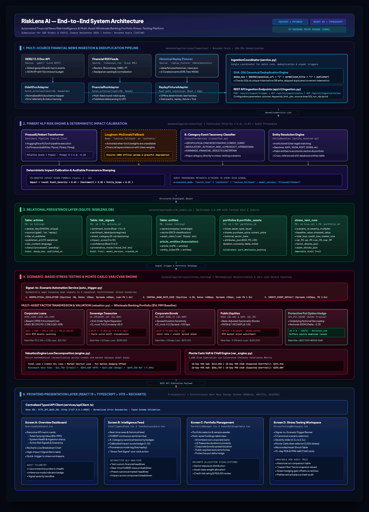
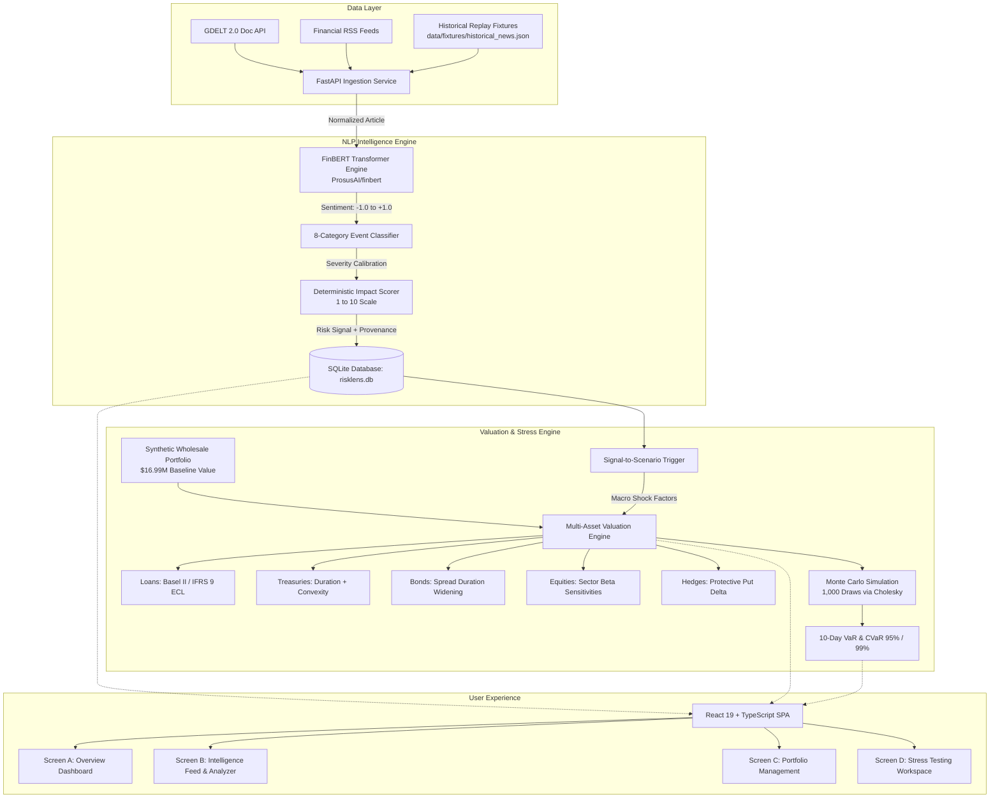

# RiskLens AI — Financial Risk Intelligence & Portfolio Stress-Testing Platform

**S&P Global & CRISIL Campus Hackathon 2026 Submission**

[](https://www.python.org/)
[](https://fastapi.tiangolo.com/)
[](https://react.dev/)
[](https://www.typescriptlang.org/)
[](https://vitejs.dev/)
[](backend/tests/)
[](LICENSE)

---

## Submission Metadata & Deliverables

- **Student / Author:** Anushka Gupta
- **Institution:** Indira Gandhi Delhi Technical University for Women (IGDTUW)
- **Competition:** S&P Global & CRISIL Campus Hackathon 2026
- **Live Demo Video:** `[Insert 5-Minute Demo Video URL]` *(Placeholder to be filled)*
- **Pitch Deck / Presentation:** `[Insert Presentation Deck URL]` *(Placeholder to be filled)*
- **Public Repository:** `https://github.com/anushkaaaguptaa/igdtuw-anushka-gupta-hackathon`

---

## Executive Summary & Problem Statement

Wholesale banking credit risk officers, asset managers, and enterprise risk committees face a critical workflow bottleneck: **unstructured global news breaks continuously, but credit loss models and market risk stress simulations operate on sluggish, manual cycles**.

When macroeconomic shocks occur (such as sudden central bank rate hikes, geopolitical conflicts, or interbank liquidity runs), risk analysts typically spend hours manually translating qualitative news headlines into quantitative risk scenarios. Furthermore, traditional risk engines frequently suffer from:
1. **Double-counting errors:** Applying mark-to-market equity haircuts on amortized-cost loans already subject to IFRS 9 / Basel II Expected Credit Loss ($\text{ECL}$).
2. **Derivative disconnection:** Failing to decouple the underlying hedged notional from contract carrying values, obscuring protective macro put hedge cushions.
3. **Lack of audit provenance:** Opaque machine learning pipelines that mix live model outputs with fallback heuristic lexicons without transparent metadata.

### Proposed Solution: RiskLens AI

**RiskLens AI** is an institutional-grade financial risk intelligence and automated stress-testing platform. It establishes an automated, mathematically rigorous bridge between qualitative financial news and multi-asset portfolio balance sheets:
- **Normalized Ingestion Pipeline:** Ingests live news from GDELT 2.0 Doc API and major financial RSS feeds, backed by deterministic historical replay fixtures with SHA-256 deduplication.
- **FinBERT NLP Risk Engine:** Employs `ProsusAI/finbert` to compute continuous sentiment polarity ($-1.0$ to $+1.0$), classifies events into an 8-category canonical taxonomy, and computes an objective $1\text{--}10$ event impact score with explicit inference provenance (`neural_live`, `synthetic`, `lexicon_fallback`).
- **Signal-to-Scenario Automation:** Dynamically links high-impact risk signals to calibrated macro stress-test scenarios with documented transmission rationales.
- **Multi-Asset Factor Valuation Engine:** Reprices wholesale banking portfolios ($16.99M baseline value) spanning commercial loans (amortized cost Basel II ECL), sovereign treasuries (duration-convexity), corporate debt (spread duration), equities (beta shocks), and protective put options (delta hedging).
- **Multi-Factor Monte Carlo VaR/CVaR:** Computes 10-day 95% and 99% Value-at-Risk and Conditional Value-at-Risk using a 1,000-draw Cholesky factor covariance simulation.

---

## System Architecture



> **Architecture Artifacts:**
> - **High-Resolution Diagram Export:** [`docs/architecture.png`](docs/architecture.png)
> - **Editable Mermaid Source Specification:** [`docs/architecture.mmd`](docs/architecture.mmd)



---

## Repository Structure

```text
igdtuw-anushka-gupta-hackathon/
├── README.md                          # Comprehensive project documentation
├── LICENSE                            # MIT License (2026 Anushka Gupta)
├── .gitignore                         # Complete exclusion of venv, node_modules, DBs, caches
│
├── backend/                           # FastAPI backend service
│   ├── app/
│   │   ├── main.py                    # Application entrypoint & CORS middleware
│   │   ├── config.py                  # Pydantic settings & environment configuration
│   │   ├── api/v1/                    # REST endpoints (health, signals, ingestion, portfolios, stress)
│   │   ├── core/                      # Database session management & logger
│   │   ├── models/                    # SQLAlchemy ORM models & Pydantic v2 schemas
│   │   ├── services/
│   │   │   ├── ingestion/             # GDELT, RSS & historical replay adapters
│   │   │   ├── nlp/                   # FinBERT classifier, sentiment & impact scorer
│   │   │   └── stress_testing/        # Multi-asset valuation, scenarios & Monte Carlo VaR
│   │   └── data/fixtures/             # Local replay fixtures
│   ├── tests/                         # Comprehensive pytest test suite (97 tests)
│   ├── requirements.txt               # Locked backend dependencies
│   ├── pytest.ini                     # Pytest asyncio configuration
│   └── .env.example                   # Safe backend environment template
│
├── frontend/                          # React 19 + TypeScript + Vite frontend
│   ├── src/
│   │   ├── App.tsx                    # Main navigation shell & tab router
│   │   ├── api/                       # Centralized typed HTTP client
│   │   ├── components/                # Modular UI components (badges, charts, cards)
│   │   ├── pages/                     # 4 primary screen views
│   │   └── styles/                    # Dark navy institutional design system
│   ├── package.json                   # Dependencies & scripts
│   ├── tsconfig.json                  # Strict TypeScript configuration
│   ├── vite.config.ts                 # Vite build & proxy configuration
│   ├── .oxlintrc.json                 # Oxlint configuration (0 errors, 0 warnings)
│   └── .env.example                   # Safe frontend environment template
│
└── data/                              # External data & audit fixtures
    ├── README.md                      # Data provenance & methodology documentation
    ├── fixtures/
    │   └── historical_news.json       # Verified historical news replay dataset (6 events)
    └── portfolios/
        └── synthetic_wholesale_portfolio.json # Calibrated wholesale banking holdings
```

---

## Data Sources & Provenance Model

RiskLens AI maintains strict boundaries between three distinct data tiers:

| Tier | Source / Format | Persistence | Provenance Audit Tag | Description |
| :--- | :--- | :--- | :--- | :--- |
| **Live External Feeds** | GDELT 2.0 Doc API & Financial RSS | Ephemeral SQLite | `source: "gdelt"` / `source: "rss"` | Real-time global financial news and macroeconomic headlines ingested via REST and XML RSS feeds. |
| **Historical Replay Fixtures** | Curated JSON Fixture (`data/fixtures/historical_news.json`) | Disk & SQLite | `source: "replay_fixture"`, `is_replay_fixture: true` | Verified historical news articles representing canonical financial events used for deterministic offline evaluation. |
| **Synthetic Portfolios** | Calibrated Financial JSON (`data/portfolios/synthetic_wholesale_portfolio.json`) | SQLite Seed | `calibration_basis: "Synthetic Wholesale Banking"` | Realistic wholesale banking multi-asset portfolio with explicit instrument risk parameters ($16.99M baseline carrying value). |

### Verified Historical Replay Events
1. **Silicon Valley Bank Deposit Run (March 2023)** — Credit event and regional banking liquidity contagion shock (`CREDIT_EVENT`).
2. **CrowdStrike Falcon Sensor Outage (July 2024)** — Operational outage halting enterprise IT systems (`PRODUCT_OPERATIONAL`).
3. **FTC Big Tech Generative AI Antitrust Inquiry (January 2024)** — Regulatory probe on cloud AI alliances (`REGULATORY_ACTION`).
4. **NVIDIA Q4 Earnings Surge (February 2024)** — AI accelerator data center revenue outperformance (`EARNINGS_FINANCIAL_RESULTS`).
5. **Federal Reserve 22-Year High Rate Hike (July 2023)** — Benchmark policy rate increase to 5.25%–5.50% (`MACROECONOMIC`).
6. **DOJ Smartphone Antitrust Suit Against Apple (March 2024)** — Civil antitrust litigation (`REGULATORY_ACTION`).

---

## Setup & Run Instructions (macOS)

### Prerequisites
- macOS 13+ (Apple Silicon or Intel)
- Python 3.11 or 3.12 (Python 3.12 recommended)
- Node.js 18+ and npm 9+
- Git

### 1. Backend Installation & Startup

```bash
# Navigate to the backend directory
cd backend

# Create a clean Python 3.12 virtual environment
python3 -m venv .venv

# Activate the virtual environment
source .venv/bin/activate

# Install required Python packages
pip install -r requirements.txt

# (Optional) Configure environment variables
cp .env.example .env

# Start the FastAPI development server
uvicorn app.main:app --host 127.0.0.1 --port 8000 --reload
```

The FastAPI backend will start at:
- **API Base URL:** `http://127.0.0.1:8000`
- **Health Check Endpoint:** `http://127.0.0.1:8000/health`
- **Interactive Swagger Documentation:** `http://127.0.0.1:8000/docs`

### 2. Frontend Installation & Startup

Open a second terminal window:

```bash
# Navigate to the frontend directory
cd frontend

# Install Node dependencies
npm install

# (Optional) Configure environment variables
cp .env.example .env

# Launch the Vite development server
npm run dev
```

The frontend application will be accessible at:
- **Web Application URL:** `http://localhost:5173`

---

## Environment Configuration

### Backend (`backend/.env` or system environment)

| Variable | Default Value | Description |
| :--- | :--- | :--- |
| `RISKLENS_DATABASE_URL` | `sqlite:///./risklens.db` | SQLite database connection string. |
| `RISKLENS_NLP_INFERENCE_MODE` | `live` | NLP execution mode: `live` (`ProsusAI/finbert`) or `mock` (keyword lexicon). |
| `DEFAULT_VAR_SIMULATION_DRAWS` | `1000` | Number of Monte Carlo simulation draws for VaR/CVaR. |
| `DEFAULT_VAR_HORIZON_DAYS` | `10` | Default time horizon in trading days for VaR calculations. |
| `GDELT_BASE_URL` | `https://api.gdeltproject.org/api/v2/doc/doc` | GDELT 2.0 Doc API query endpoint. |
| `GDELT_TIMEOUT_SECONDS` | `10.0` | Network request timeout for external news ingestion. |

### Frontend (`frontend/.env`)

| Variable | Default Value | Description |
| :--- | :--- | :--- |
| `VITE_API_BASE_URL` | `http://localhost:8000` | Target FastAPI backend URL. |

---

## Verification & Test Suite

The platform includes a rigorous test suite spanning ingestion normalization, NLP scoring, multi-asset valuation mathematics, and full API reconciliation.

### Run Backend Tests (pytest)

```bash
cd backend
source .venv/bin/activate
pytest tests/
```

**Verified Test Result:**
```text
============================= test session starts ==============================
platform darwin -- Python 3.12.7, pytest-9.1.1, pluggy-1.7.0
rootdir: /Users/anushkagupta/risk ai/backend
configfile: pytest.ini
plugins: asyncio-1.4.0, anyio-4.15.1
collected 97 items

tests/test_api_endpoints.py ...                                          [  3%]
tests/test_db_models.py ....                                             [  7%]
tests/test_health.py ...                                                 [ 10%]
tests/test_ingestion_adapters.py ......                                  [ 16%]
tests/test_ingestion_api.py ...                                          [ 19%]
tests/test_ingestion_live_probe.py ..                                    [ 21%]
tests/test_ingestion_normalization.py .....                              [ 26%]
tests/test_ingestion_service.py ....                                     [ 30%]
tests/test_nlp_classifier.py .........                                   [ 40%]
tests/test_nlp_entity_resolver.py .....                                  [ 45%]
tests/test_nlp_impact_scorer.py .....                                    [ 50%]
tests/test_nlp_pipeline_integration.py ......                            [ 56%]
tests/test_nlp_sentiment.py .......                                      [ 63%]
tests/test_stress_api.py ......                                          [ 70%]
tests/test_stress_engine_reconciliation.py ......                        [ 76%]
tests/test_stress_scenarios.py .....                                     [ 81%]
tests/test_stress_valuation.py .............                             [ 94%]
tests/test_stress_var_cvar.py .....                                      [100%]

============================== 97 passed in 31.25s ==============================
```

### Run Frontend Linter & Production Build

```bash
cd frontend

# Code quality and syntax validation
npm run lint
# Output: Found 0 warnings and 0 errors.

# Production TypeScript compilation and Vite build
npm run build
# Output: built in ~370ms, generating optimized route-split chunks
```

---

## Financial Methodology & Key Illustrative Results

### 1. Valuation Mathematics & Loss Accounting

RiskLens AI models each asset class under its true regulatory and market mechanics:

- **Commercial Loans (Amortized Cost / Basel II ECL):**
  $$\text{Carrying Value} = \text{EAD} - \text{ECL}_{\text{base}}$$
  $$\Delta \text{Loss} = \text{EAD} \cdot \left(\text{PD}_{\text{stressed}} \cdot \text{LGD}_{\text{stressed}} - \text{PD}_{\text{base}} \cdot \text{LGD}_{\text{base}}\right)$$
  *Zero Double-Counting:* Market equity discounts are strictly omitted on commercial loans held at amortized cost.

- **Sovereign Treasuries (2nd-Order Taylor Duration-Convexity):**
  $$\frac{\Delta P}{P} \approx -D_{\text{mod}} \cdot \Delta y + \frac{1}{2} C \cdot (\Delta y)^2$$

- **Corporate Bonds (Spread Duration):**
  $$\frac{\Delta P}{P} \approx -D_{\text{mod}} \cdot (\Delta y + \Delta s)$$

- **Derivative Macro Hedges (Delta Hedging):**
  $$\Delta V \approx \Delta \cdot \frac{\Delta S}{S} \cdot \text{Notional}_{\text{underlying}}$$
  Decouples the $10.0M protected equity notional from the $250,000 contract premium carrying value.

### 2. Benchmark Scenario Result: Central Bank Rate Hike (+150 bps)

Below are the reconciled simulation results for the benchmark wholesale banking portfolio under the `CENTRAL_BANK_RATE_HIKE` scenario:

| Metric | Baseline Value | Stressed Value | Absolute Change | Percentage |
| :--- | :--- | :--- | :--- | :--- |
| **Total Portfolio Value** | **$16,993,750.00** | **$16,298,400.00** | **-$695,350.00** | **-4.09%** |
| • Corporate Loan (`ACME_CORP_LOAN`) | $4,943,750.00 | $4,887,500.00 | -$56,250.00 (ECL) | -1.14% |
| • US Treasury 10Y (`US_TREASURY_10Y`) | $4,000,000.00 | $3,561,400.00 | -$438,600.00 | -10.97% |
| • Corporate Bond 5Y (`MS_CORP_BOND_5Y`) | $3,000,000.00 | $2,685,000.00 | -$315,000.00 | -10.50% |
| • NVIDIA Equity (`NVDA`) | $2,600,000.00 | $2,147,600.00 | -$452,400.00 | -17.40% |
| • Apple Equity (`AAPL`) | $2,200,000.00 | $1,922,800.00 | -$277,200.00 | -12.60% |
| • Put Option Hedge (`SPX_PUT_HEDGE`) | $250,000.00 | $670,000.00 | **+$420,000.00 (Gain)** | **+168.00%** |

**Illustrative 10-Day Monte Carlo Risk Metrics (1,000 Draws):**
- **95% 10-Day VaR:** $213,850 | **95% 10-Day CVaR (Expected Shortfall):** $274,916
- **99% 10-Day VaR:** $301,769 | **99% 10-Day CVaR (Expected Shortfall):** $359,089

---

## Known Assumptions & Limitations

1. **Synthetic Covariance Structure:** The Monte Carlo simulation employs a calibrated Cholesky factor covariance matrix across interest rates, equity returns, and credit spreads over a 10-day horizon. These tail metrics represent scenario benchmarking approximations rather than real-time exchange feeds.
2. **First-Order Derivative Greeks:** Option hedging models currently apply delta sensitivity approximations ($\Delta = -0.35$). Higher-order Greeks (Gamma $\Gamma$, Vega $\mathcal{V}$, Theta $\Theta$) and dynamic Black-Scholes implied volatility surfaces are reserved for production extensions.
3. **Amortized Cost ECL Assumption:** Commercial loans assume hold-to-maturity accounting without secondary distressed debt liquidation discounts.

---

## License

This project is licensed under the [MIT License](LICENSE) — see the LICENSE file for details.

Copyright (c) 2026 Anushka Gupta.
